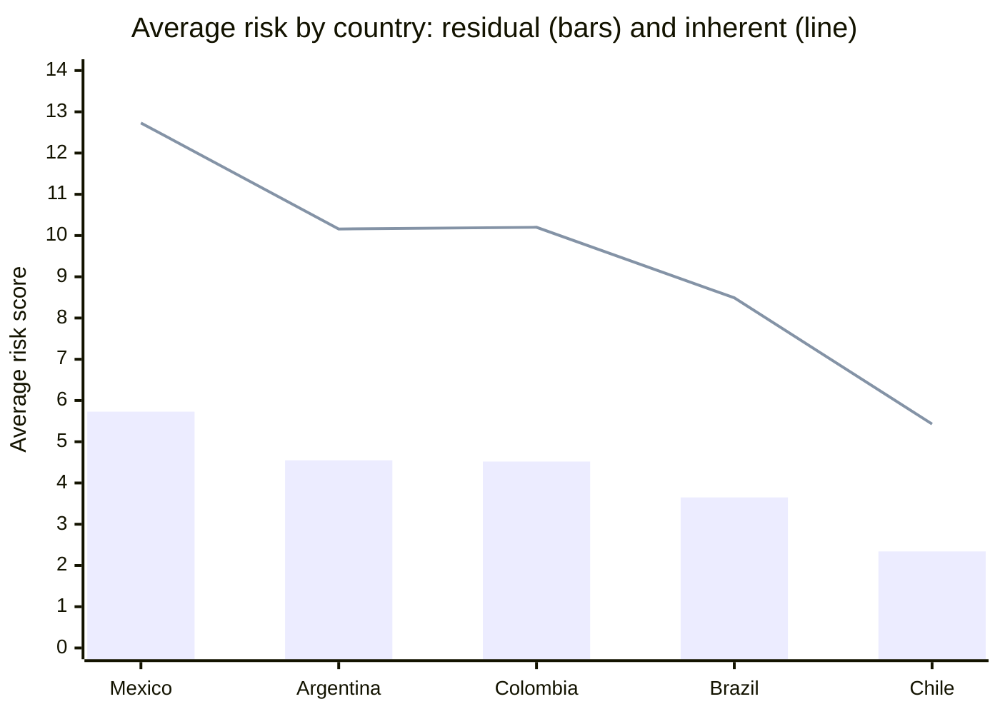
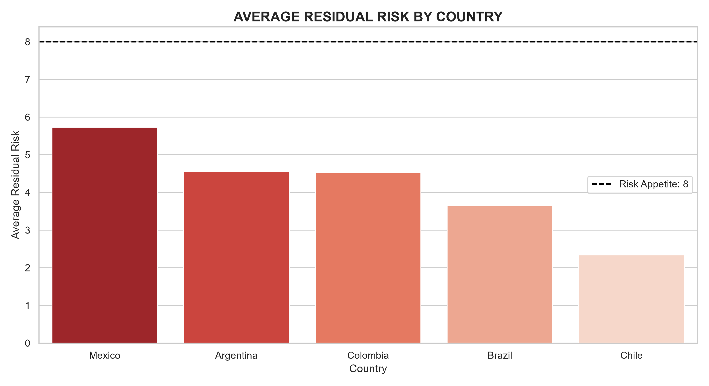
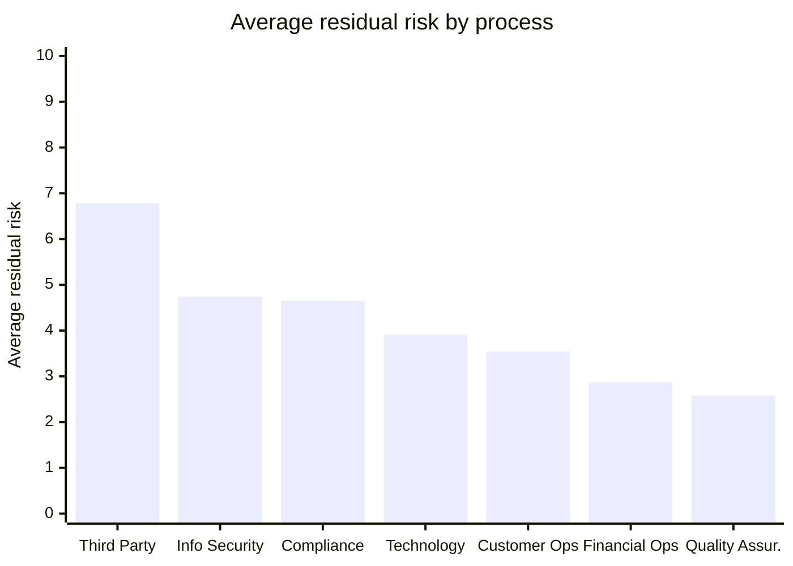
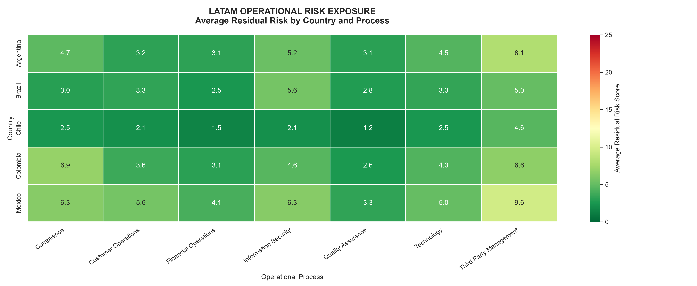
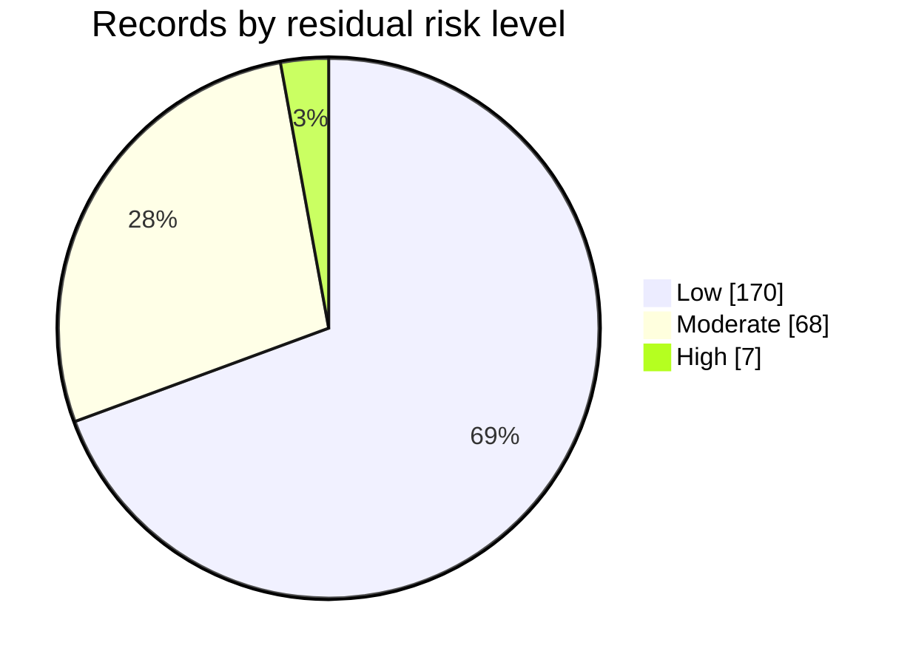
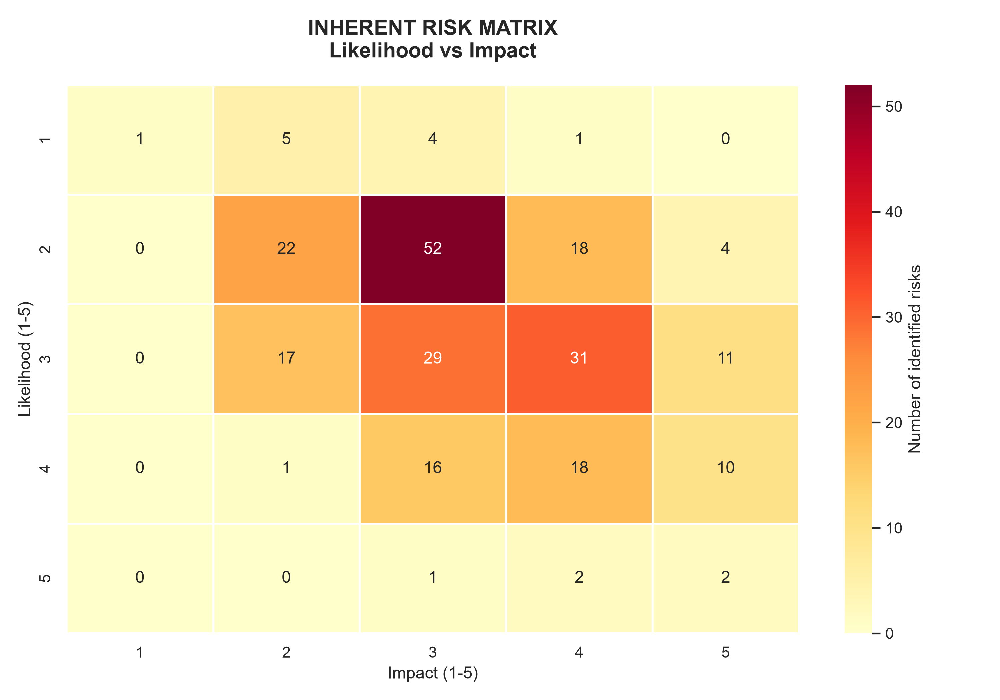
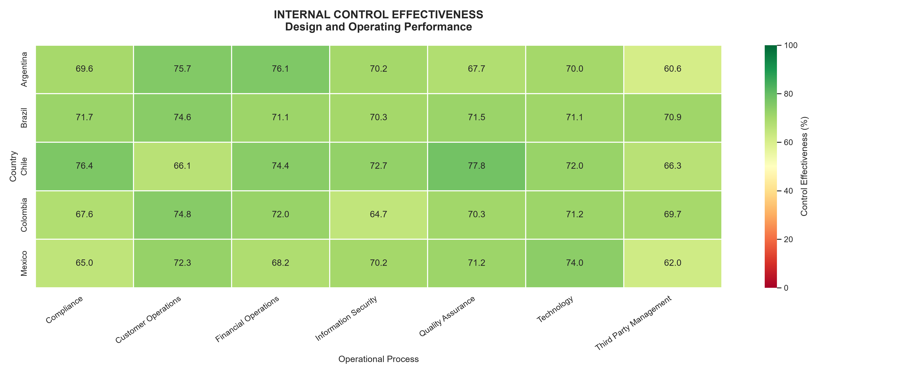
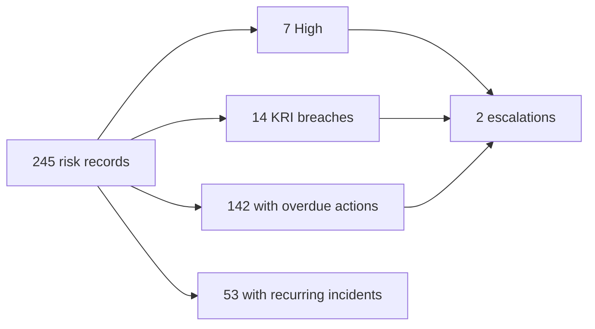
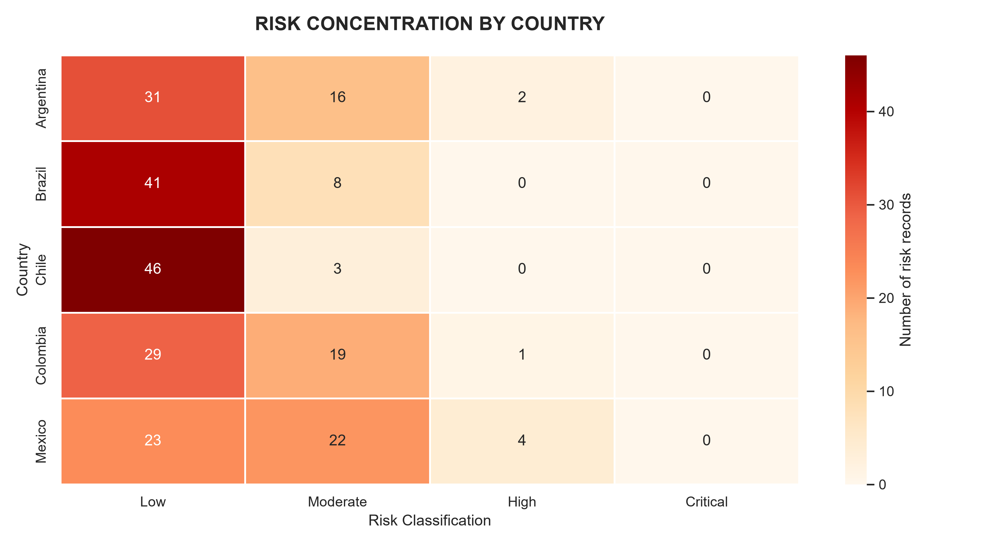
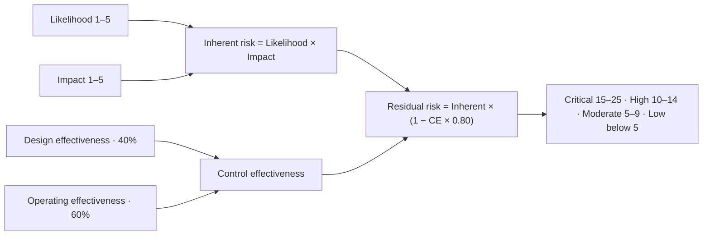

## 📊 Results Dashboard

  

  
  
  
  

  
  
  
  

I organized the results in five chapters. Each one starts from the full portfolio and ends with the records that have the highest residual risk.

---

### 🌎 Chapter 1 · Residual risk by country

Average residual risk ranges from 2.34 (Chile) to 5.73 (Mexico). All five countries are below the risk appetite of 8 used in this project. In the chart, the bars show the average after controls and the line shows the average before controls.

| Country | Avg. residual risk (bar scale 0–10) | Avg. inherent | High | KRI breaches | Records with overdue actions | Records with recurring incidents | Incidents (90 days) |
|---|---|---:|---:|---:|---:|---:|---:|
| 🇲🇽 Mexico | `███████████░░░░░░░░░` **5.73** | 12.73 | 4 | 5 | 29 | 11 | 90 |
| 🇦🇷 Argentina | `█████████░░░░░░░░░░░` **4.55** | 10.16 | 2 | 5 | 32 | 14 | 78 |
| 🇨🇴 Colombia | `█████████░░░░░░░░░░░` **4.52** | 10.20 | 1 | 4 | 32 | 13 | 83 |
| 🇧🇷 Brazil | `███████░░░░░░░░░░░░░` **3.65** | 8.49 | 0 | 0 | 28 | 8 | 51 |
| 🇨🇱 Chile | `█████░░░░░░░░░░░░░░░` **2.34** | 5.43 | 0 | 0 | 21 | 7 | 46 |

---

### 🏭 Chapter 2 · Residual risk by process

Third Party Management has the highest average residual risk (6.78) and the lowest average control effectiveness (65.9%). The highest country and process average is Mexico × Third Party Management (9.6), followed by Argentina × Third Party Management (8.1). These are the only two cells above 8.

**Heatmap:** 🟩 below 3 · 🟨 3 to 5 · 🟧 5 to 8 · 🟥 8 or above

| Country | ⚖️ | 🎧 | 💰 | 🔐 | ✅ | 💻 | 🤝 |
|---|---:|---:|---:|---:|---:|---:|---:|
| 🇲🇽 Mexico | 🟧 6.3 | 🟧 5.6 | 🟨 4.1 | 🟧 6.3 | 🟨 3.3 | 🟧 5.0 | 🟥 9.6 |
| 🇦🇷 Argentina | 🟨 4.7 | 🟨 3.2 | 🟨 3.1 | 🟧 5.2 | 🟨 3.1 | 🟨 4.5 | 🟥 8.1 |
| 🇨🇴 Colombia | 🟧 6.9 | 🟨 3.6 | 🟨 3.1 | 🟨 4.6 | 🟩 2.6 | 🟨 4.3 | 🟧 6.6 |
| 🇧🇷 Brazil | 🟩 3.0 | 🟨 3.3 | 🟩 2.5 | 🟧 5.6 | 🟩 2.8 | 🟨 3.3 | 🟧 5.0 |
| 🇨🇱 Chile | 🟩 2.5 | 🟩 2.1 | 🟩 1.5 | 🟩 2.1 | 🟩 1.2 | 🟩 2.5 | 🟨 4.6 |

⚖️ Compliance · 🎧 Customer Operations · 💰 Financial Operations · 🔐 Information Security · ✅ Quality Assurance · 💻 Technology · 🤝 Third Party Management

| Process | Avg. residual risk (bar scale 0–10) | Control effectiveness | Records with overdue actions |
|---|---|---:|---:|
| 🤝 Third Party Management | `██████████████░░░░░░` **6.78** | 65.9% | 20 |
| 🔐 Information Security | `█████████░░░░░░░░░░░` **4.74** | 69.6% | 22 |
| ⚖️ Compliance | `█████████░░░░░░░░░░░` **4.65** | 70.1% | 25 |
| 💻 Technology | `████████░░░░░░░░░░░░` **3.92** | 71.7% | 20 |
| 🎧 Customer Operations | `███████░░░░░░░░░░░░░` **3.55** | 72.7% | 21 |
| 💰 Financial Operations | `██████░░░░░░░░░░░░░░` **2.87** | 72.3% | 16 |
| ✅ Quality Assurance | `█████░░░░░░░░░░░░░░░` **2.58** | 71.7% | 18 |

---

### 🎯 Chapter 3 · Inherent risk before controls

The most frequent combination is likelihood 2 and impact 3 (52 records), followed by likelihood 3 with impact 4 (31 records) and likelihood 3 with impact 3 (29 records). After controls, 170 records are Low, 68 are Moderate and 7 are High.

---

### 🛠️ Chapter 4 · Control effectiveness

58 records have an operating control weakness (average operating effectiveness 52.9%), 25 have a design weakness, 15 have a gap between design and operation, and 147 show no major gap.

| Type of control weakness | Records | Share of 245 |
|---|---:|---|
| ⚙️ Operating control weakness | 58 | `█████░░░░░░░░░░░░░░░` 24% |
| 📐 Control design weakness | 25 | `██░░░░░░░░░░░░░░░░░░` 10% |
| ↔️ Design vs operating gap | 15 | `█░░░░░░░░░░░░░░░░░░░` 6% |
| ✅ No major gap identified | 147 | `████████████░░░░░░░░` 60% |

---

### 🚨 Chapter 5 · Actions, incidents and escalation

142 records (58%) have at least one overdue action, 53 have recurring incidents and 14 exceed the KRI threshold of 3 incidents in 90 days. Two records were flagged for escalation.

---

📖 <b>How the numbers are calculated</b>

> **Notes**
> - The data is synthetic. Thresholds, weights, the risk appetite of 8 and the KRI threshold of 3 are assumptions defined for this project. They are not COSO or ISO 31000 values.
> - In the tables above, "records with overdue actions" counts records. The Excel summaries count the total number of overdue actions, so the two figures differ.
> - The images are in the repository root and in `readme_assets/`. The overview image is generated by `readme_assets/make_overview.py`.
